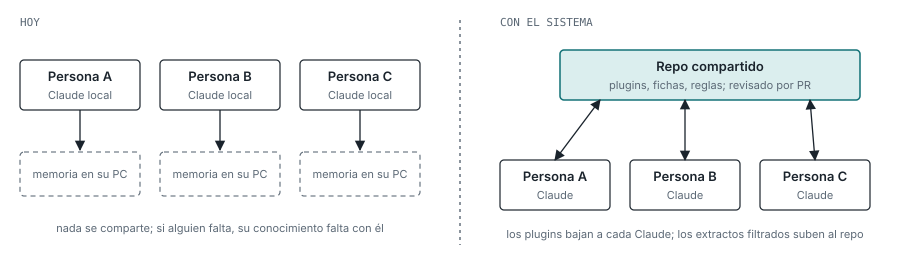

# Qué queremos

Hoy cada persona trabaja con Claude Code en su PC y el conocimiento que genera se queda allí.
Queremos que ese conocimiento sea de la organización, que el trabajo pueda continuarlo otra
persona, y que cueste cada vez menos.

## Dos necesidades

1. **Conocimiento compartido del departamento.** Unificar y persistir lo que hoy cada uno tiene en
   local tras trabajar con Claude Code: agentes, skills, MCPs, reglas, y también el conocimiento
   funcional del negocio. Que alguien nuevo parta de algo, y que nada dependa del PC de nadie.
   **Es la fase 1 y el alcance de este repositorio.**
2. **Gestión del trabajo con agentes.** Primero para una persona y, si funciona, para la
   organización. Menos tareas encargadas a los agentes, menos coste en modelos caros, y
   continuidad desde otro equipo o cuenta. **Es la fase 2 y no está aquí todavía.**

## Objetivos que debe cumplir cualquier solución

- **Continuidad.** Si alguien falta, otra persona continúa su trabajo con lo que hay en común.
- **Conocimiento vivo.** Lo que nace en un hilo personal acaba como regla, skill, agente o ficha
  de la organización. Se consolida sin parar: crece, pero también elimina ambigüedades y
  contradicciones.
- **Cumplimiento sin imponer forma de trabajar.** Lo obligatorio son reglas, convenciones y
  procesos. Cada proyecto o responsabilidad trae su paquete y Claude lo integra. La captura del
  trabajo diario es opcional.
- **Coste mínimo** y **agentes invisibles sin pérdida**: objetivos de la fase 2, que el diseño de
  la fase 1 no debe impedir.

## La diferencia, en un diagrama

Hoy no hay ningún arco entre personas. Con el sistema, todo pasa por un repositorio común que se
revisa por PR.

## Las estructuras de memoria que existen

En Claude Code las estructuras son CLAUDE.md y reglas, agentes, skills, comandos, hooks, MCPs y la
auto-memoria por proyecto. Solo la auto-memoria es local y sin revisar. Es justo la que este
sistema sustituye.
