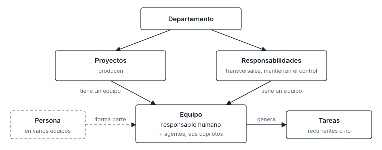

# Modelo organizativo

Cada departamento tiene proyectos, que producen, y responsabilidades, que son transversales y
mantienen el control. Debajo de cada uno hay un equipo: un responsable humano y sus agentes, que
son sus copilotos. Todo se reduce a tareas, recurrentes o no, que antes hacía una persona y ahora
hace con ayuda de agentes. Una persona forma parte de varios equipos.

El árbol de departamentos, responsabilidades y proyectos es un fichero pequeño del catálogo
maestro (`07-convencion.md`). Al principio tendrá pocas responsabilidades; reorganizarlo es una
tarea constante, no un fallo.

## Reorganizar como constante

Tres reglas hacen barata la reorganización
(`../adr/2026-10-20-identidad-por-identificador.md`):

1. **La identidad no es la ubicación.** Cada ficha, skill, agente y regla tiene un identificador
   estable, y las referencias son por identificador, nunca por ruta. Mover algo no rompe nada, y
   el validador comprueba que toda referencia resuelve.
2. **"Sin sitio" es un estado legítimo.** Cada departamento tiene una bandeja de entrada. Al
   principio, con pocas responsabilidades, casi todo caerá ahí.
3. **La reorganización es una pasada más del consolidador**, con reglas escritas: una carpeta que
   supera un tamaño se parte, una ficha citada por dos responsabilidades sube al departamento, una
   bandeja con muchas fichas del mismo tema propone una responsabilidad nueva. Propone movimientos
   como PRs y una persona fusiona.
