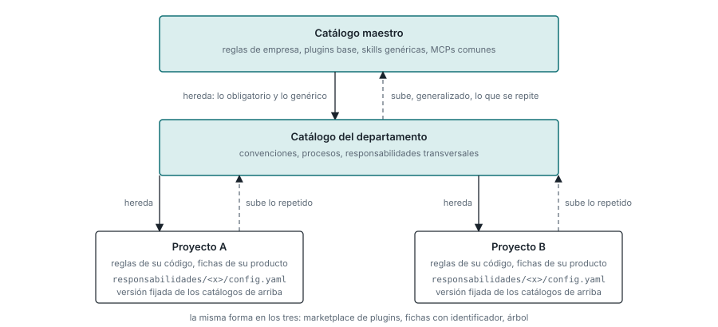
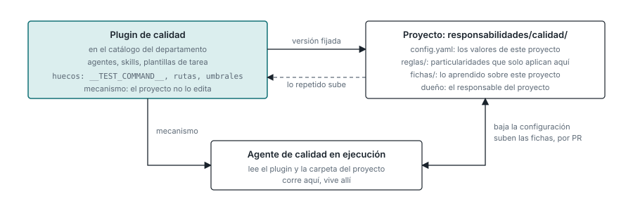

# Catálogos: tres niveles con la misma forma

Un catálogo es siempre lo mismo: un marketplace de plugins de Claude Code, fichas con
identificador y un árbol. Solo cambia el alcance. Hay uno maestro para la organización, uno por
departamento, y el de cada proyecto, que no es un repositorio aparte sino una estructura de
carpetas dentro del repositorio del proyecto. Como la forma es idéntica, una cosa puede subir de
nivel sin cambiar de forma, y un proyecto consume los tres a la vez
(`../adr/2026-10-20-tres-niveles-de-catalogo.md`).

| Nivel | Qué tiende a vivir ahí | Quién fusiona |
|---|---|---|
| Maestro, la organización | Reglas de empresa, los plugins base (captura, validador, kit de arranque), skills genéricas, MCPs de sistemas comunes | Un grupo pequeño; lo obligatorio para todos, con dos personas |
| Departamento | Convenciones y procesos del departamento, las responsabilidades transversales, conocimiento del dominio común a sus productos | El responsable de conocimiento del departamento |
| Proyecto | Reglas de esa base de código, fichas funcionales de ese producto, agentes ajustados a él, y la configuración de cada responsabilidad transversal que se le aplica | El responsable del proyecto |



## Hacia abajo se hereda; hacia arriba se generaliza

Un proyecto recibe maestro más departamento más lo suyo, y lo más específico gana, salvo en lo que
el nivel superior marca como obligatorio, que no se puede anular. Lo obligatorio va por la
configuración gestionada de Claude Code; lo demás, por la configuración del proyecto.

Subir cuesta trabajo, y el trabajo es siempre el mismo: **lo que sube pierde nombres y gana
parámetros**. Una skill de proyecto que dice "ejecuta el comando de tests de este proyecto y
revisa el módulo de facturación" sube al departamento como "ejecuta el comando de tests del
proyecto y revisa el módulo que la tarea indique", y el proyecto conserva solo su configuración.

## El ascensor

Es una pasada más del consolidador. Cuando dos proyectos del mismo departamento tienen una regla,
skill o agente casi iguales, propone una PR al catálogo superior con la versión generalizada, y
otra a cada proyecto que sustituye su copia por una referencia al identificador de arriba más sus
parámetros. Lo mismo entre departamentos hacia el maestro. Nadie decide crear un catálogo
maestro: se llena porque las repeticiones suben solas, por PR. Lo que no se repite se queda donde
está. La mayor parte del conocimiento funcional no sube porque es de un producto; lo que sube son
procesos, convenciones, agentes, skills y MCPs.

## Versiones

Cada catálogo se etiqueta. Un proyecto fija la versión de los catálogos que usa, y el consolidador
le propone subir como una PR más, con el diff de lo que cambia para él. Si tres proyectos
sobrescriben la misma generalización, la generalización estaba mal y se corrige arriba.

## La configuración de una responsabilidad vive en el proyecto

Dónde corre una cosa no es dónde vive. Una responsabilidad transversal, calidad o seguridad, corre
sobre cada proyecto, pero su plugin vive en el catálogo del departamento, escrito con huecos: el
comando de tests, las rutas, los umbrales, a quién avisar. Cada proyecto rellena esos huecos en
una carpeta suya, con un nombre fijo por convención, y el plugin la lee al arrancar. Si falta un
valor, el plugin lo dice y no inventa uno.

```
proyecto/
  .claude/                    lo de Claude Code: settings, rules, CLAUDE.md
  responsabilidades/
    calidad/
      config.yaml             los valores de este proyecto para ese plugin
      reglas/                 particularidades que solo aplican aquí
      fichas/                 lo que la responsabilidad ha aprendido de este proyecto
    seguridad/
      config.yaml
  fichas/                     conocimiento funcional del producto
```



- **Al plugin del departamento** va lo que es igual en todos los proyectos o se puede escribir con
  huecos.
- **A la carpeta del proyecto** va lo que cambia de proyecto a proyecto, y lo que la
  responsabilidad descubre sobre ese proyecto, que son fichas de ese proyecto aunque las haya
  escrito un agente del departamento.
- **La duda se resuelve con el ascensor**, no de antemano.

La carpeta del proyecto gana sobre los valores por defecto del plugin, salvo en lo obligatorio. El
dueño de la carpeta es el responsable del proyecto; el agente de la responsabilidad escribe ahí
solo fichas, y por PR. Clonar el proyecto trae todo lo necesario para ejecutar sus
responsabilidades. Lo único que el departamento fija es la convención.
