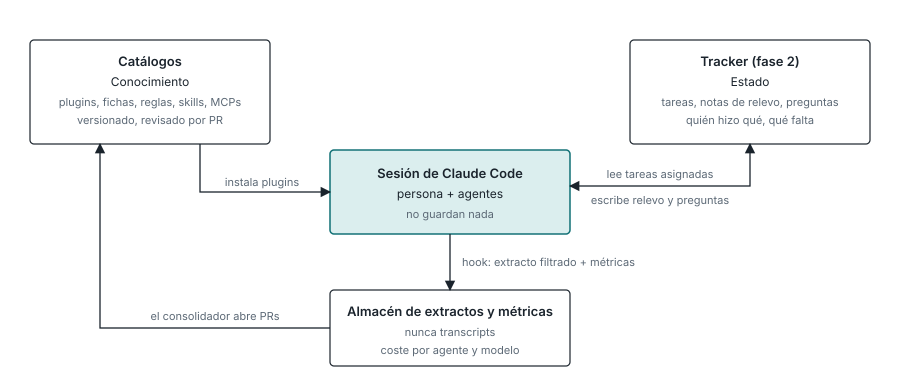
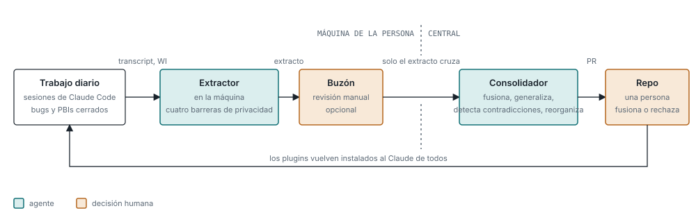

# El bucle de conocimiento

## El principio: los agentes no guardan nada

Cada dato va a su casa según su naturaleza (`../adr/2026-10-20-los-agentes-no-guardan-nada.md`).
El conocimiento, versionado y revisado, vive en los catálogos. Los extractos y las métricas van a
un almacén. El estado de las tareas irá al tracker en la fase 2. Un agente escribe en las casas por
hook y no se lleva nada al hilo.

## De la producción diaria a los plugins de todos

- **Extractor, local, en la máquina de cada persona.** Lee los transcripts del día y los work
  items cerrados y produce un extracto: conocimiento candidato y métricas. Aplica las cuatro
  barreras de privacidad (`05-privacidad.md`). Solo el extracto va a un buzón de salida.
- **Buzón.** Quien se apunte voluntariamente lo revisa a mano antes de sincronizar. Para el
  propietario del sistema, automático.
- **Consolidador, central.** Lee los extractos de todas las personas y abre PRs a los catálogos:
  una regla nueva, una skill corregida, una contradicción entre dos reglas, un movimiento de sitio,
  una generalización que sube de nivel. Nunca ve un transcript.
- **Fusión humana.** La única puerta de entrada al conocimiento común es una PR que fusiona una
  persona. Nadie recibe instrucciones de cómo trabajar; solo recibe PRs.
- **Vuelta.** Lo fusionado llega instalado como plugin al Claude de todos.

Las primeras PRs serán malas. Lo que se ajusta no es cada PR sino el prompt del consolidador, que
vive en el catálogo maestro y cambia por PR como todo lo demás.

## Ejecución

El extractor corre en la máquina de la persona por cron o systemd, de noche, en modo headless. El
consolidador corre, al principio, en la máquina del propietario; más adelante en un runner o como
rutina programada en la nube de Claude Code. Ninguna de las dos piezas necesita infraestructura
nueva para empezar.
