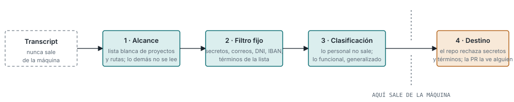

# Privacidad: el transcript no sale de la máquina

El filtro actúa antes de que exista el extracto, no después
(`../adr/2026-10-20-el-transcript-no-sale-de-la-maquina.md`).

1. **Alcance por lista blanca.** Solo se captura lo vinculado a un proyecto o responsabilidad
   declarados. Una sesión sin etiqueta, o sobre una ruta marcada como privada en la configuración
   de la persona, no se lee. Lo no declarado no existe para el sistema.
2. **Filtro determinista, sin modelo.** Patrones de secretos, credenciales, cadenas de conexión,
   correos, teléfonos, identificadores personales y bancarios, y una lista de términos de la
   organización: nombres de clientes, de personas, nombres en clave. Lo que coincide se sustituye
   por un marcador antes de que el extractor lo lea.
3. **Clasificación por el extractor.** Cada candidato se etiqueta como técnico, de proceso o
   funcional, y se marca si contiene datos de una persona, de un cliente, condiciones económicas o
   situaciones particulares. Lo marcado no sale. Lo funcional sale solo generalizado: "los clientes
   de este tipo suelen pedir X" sí; "el cliente Y pidió X el martes" no. La instancia concreta vive
   en el work item de ese proyecto, que ya tiene su control de acceso.
4. **Comprobación en destino.** El catálogo tiene una comprobación automática que rechaza cualquier
   PR con un secreto o un término de la lista, y la PR la ve una persona.

## Configuración por persona

Un fichero personal, fuera del repositorio, con sus rutas privadas, los proyectos que declara y si
revisa el buzón a mano. El filtro se prueba contra transcripts reales antes de activarlo: esa
prueba vale más que cualquier diseño del filtro.

## Telemetría

Las métricas de coste que Claude Code exporta no incluyen el contenido de los prompts salvo
activación expresa, y los atributos de cuenta se pueden quitar por configuración. Se verifica al
activar la exportación.
