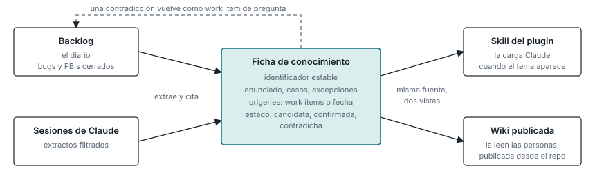

# Conocimiento funcional: el backlog es la fuente; el catálogo es la casa

El backlog es un diario: qué quisimos hacer, cuándo, por qué, qué se rompió. Sus unidades se
cierran y pasan a ser historia. El conocimiento funcional es un mapa: cómo se comporta hoy el
producto o el negocio, qué reglas y qué casos existen. Sus unidades no se cierran, se consolidan.
Un mapa no sale de un diario sin consolidación, y esa consolidación es lo que cada equipo hace hoy
a mano (`../adr/2026-10-20-el-backlog-es-fuente-el-repo-es-casa.md`).

## Cómo se relacionan

El conocimiento no cuelga de un work item: lo cita. Una ficha lleva sus orígenes: un bug, un PBI,
o ninguno y solo la fecha del extracto del que salió. El backlog ya escrito es una fuente más: el
extractor lee bugs y PBIs cerrados igual que lee transcripts, y una pasada inicial sobre el backlog
existente produce las primeras fichas. En sentido contrario, cuando el consolidador encuentra una
ficha que contradice los criterios de un PBI abierto, crea un work item de pregunta.

## La ficha

Un concepto por fichero: enunciado, casos, excepciones, orígenes, estado y un identificador
estable (`07-convencion.md`). Unificar es que todos usen esa forma. Compactar es el trabajo del
consolidador: fusionar duplicados, resolver contradicciones, generalizar.

## Una fuente, dos vistas

Para Claude, las fichas de un proyecto se empaquetan como skills de su plugin y se cargan bajo
demanda cuando el tema aparece. Las reglas son pequeñas y van al contexto de sesión; el
conocimiento es grande y va en skills. Para las personas, el repositorio publica la carpeta de
fichas como wiki, así que leen el mapa en la wiki que ya usan y la fuente sigue siendo el
repositorio.
